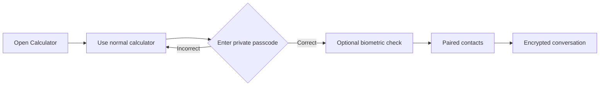

<div align="center">

# 🧮 Calculator

### A full calculator with an optional private messaging space

A familiar calculator on the surface. Enter your private passcode to open an encrypted, paired conversation experience.

[](https://flutter.dev)
[](https://dart.dev)
[](https://www.android.com)
[](LICENSE)
[](https://github.com/Keshab1997/secret-calculator/releases)

</div>

---

## ✨ Overview

Calculator is a Flutter app that keeps its everyday calculator experience separate from a private messaging area. The default passcode is **`1997`** and can be changed from the in-app security settings.

| Calculator | Private space |
|---|---|
| Standard arithmetic and percentages | One-to-one paired conversations |
| Live expressions and formatted results | Text, emoji and stickers |
| Local calculation history | Encrypted photos and voice notes |
| Classic black, grey and orange design | Voice/video calling experience |
| Works even when Firebase is unavailable | Presence, last seen and call history |

> [!IMPORTANT]
> A disguised interface is a privacy convenience—not a guarantee of anonymity. Read the [Privacy, Safety & Acceptable Use Policy](PRIVACY_POLICY.md) before using the messaging features.

## 🌟 Features

### 🧮 Calculator experience

- Addition, subtraction, multiplication, division and percentages
- Decimal and scientific-result handling
- Scrollable full expressions with live results
- Persistent local calculation history
- Familiar dark calculator design
- Calculator remains usable if cloud services are unavailable

### 💬 Messaging experience

- Contact pairing by Personal ID with explicit accept/decline controls
- Legacy secure invitations in `ROOMID.SECRET` format
- Text messages, emoji search and sticker packs
- On-device encryption for supported message and media content
- Encrypted photo sharing and temporary voice-note playback files
- Voice and video call screens with call summaries
- Online presence, last seen and profile information
- Search, dark mode and disappearing-message preferences
- Calculator-themed notification text for discretion
- Optional biometric lock and a separate decoy passcode
- Screenshot and Recent Apps protection on private screens

### 🔐 Security design

- Anonymous Firebase Authentication identifies each installation
- P-256 ECDH and HKDF-SHA-256 derive a separate key for each paired room
- AES-256-GCM protects supported message and media content
- Passcodes, private key material and room secrets use protected device storage
- High-entropy room secrets are separate from short room identifiers
- Firebase Realtime Database and Storage rules restrict room data to members

> [!CAUTION]
> First contact is not cryptographically authenticated against a pre-existing trusted identity. Verify the other person's Personal ID through an independent trusted channel. Encryption also cannot protect content on a compromised/unlocked device or prevent a recipient from copying it.

## 🚀 How it works



1. Open the app and use it as a normal calculator.
2. Enter **`1997`** (or your custom passcode).
3. Complete biometric verification if it is enabled.
4. Pair a trusted contact by Personal ID, or exchange the complete legacy secure invite through a trusted channel.
5. Start a private conversation.

A six-character room ID by itself is **not** sufficient to join a secure room.

## 🛠️ Technology

| Area | Technology |
|---|---|
| Application | Flutter 3.47.7, Dart, Material Design 3 |
| Identity | Firebase Anonymous Authentication |
| Realtime data | Firebase Realtime Database |
| Media | Firebase Storage |
| Notifications | Firebase Cloud Messaging + local notifications |
| Diagnostics | Firebase Crashlytics |
| Cryptography | P-256 ECDH, HKDF-SHA-256, AES-256-GCM |
| Local protection | Flutter Secure Storage, device biometrics |
| Calls | WebRTC and native Android audio integration |
| Backend helpers | Firebase Cloud Functions (TypeScript) |

## 🧑‍💻 Local development

### Requirements

- Flutter **3.47.7**
- A supported Android/iOS development environment
- A Firebase project for messaging features
- Anonymous Authentication, Realtime Database and Storage enabled

### Get started

```bash
git clone https://github.com/Keshab1997/secret-calculator.git
cd secret-calculator
flutter pub get
flutter run
```

### Firebase configuration

The Firebase configuration is intentionally not committed.

1. Register the Android application ID `com.keshabstudios.calculator` in Firebase.
2. Place your local `google-services.json` in `android/app/`.
3. Enable **Authentication → Sign-in method → Anonymous**.
4. Review and deploy [`database.rules.json`](database.rules.json) and [`storage.rules`](storage.rules).
5. Review the functions in [`functions/`](functions/) before deploying them.

> [!WARNING]
> Never commit `google-services.json`, signing keystores, `key.properties`, tokens or other credentials. Repository workflows receive sensitive configuration through GitHub Actions secrets.

For the complete production checklist, read [`docs/security-cutover.md`](docs/security-cutover.md) and [`docs/personal-id-pairing.md`](docs/personal-id-pairing.md).

## ✅ Checks and builds

Use the smallest check that covers a change:

```bash
python3 tool/preflight.py
flutter test test/<name>_test.dart
```

Shared or risky Dart changes should also run:

```bash
flutter analyze
flutter test
```

GitHub Actions are manual in this repository:

- **Flutter CI** — formatting, analysis and tests
- **Build Android APK or AAB** — downloadable Android artifacts
- **Publish Signed Android Release** — versioned release artifacts
- **Web Preview** — browser preview for supported screens

A push does not automatically start CI. Run the appropriate workflow from the **Actions** tab after a batch is ready.

## 🗂️ Project layout

```text
lib/
├── models/       # Calculator, stickers and message-effect models
├── screens/      # Calculator, chats, calls, pairing and profile screens
├── services/     # Firebase, encryption, native bridge and notifications
└── widgets/      # Shared messaging, security and policy UI

functions/        # Firebase Cloud Functions
test/             # Unit and widget tests
docs/             # Security, pairing and design notes
tool/             # Preflight, CI and agent utilities
```

## 📚 Documentation

| Document | Purpose |
|---|---|
| [Privacy Policy](PRIVACY_POLICY.md) | Data handling, safety and acceptable use |
| [Security cutover](docs/security-cutover.md) | Firebase deployment and migration checklist |
| [Personal ID pairing](docs/personal-id-pairing.md) | Pairing protocol, trust boundaries and backend data |
| [Stealth and optimization](docs/stealth-and-optimization.md) | Privacy controls, caching and Firebase usage |
| [Calculator behavior](docs/calculator.md) | Calculator model and interaction details |
| [Code review](docs/CODE-REVIEW.md) | Security and implementation review history |

## ⚠️ Responsible use

Do not use this project for harassment, stalking, threats, fraud, exploitation, non-consensual intimate content, child sexual abuse material, unauthorized access, hiding evidence, or any illegal or harmful activity. Users are responsible for their messages, consent requirements and compliance with local law.

If you receive harmful or illegal content, stop engaging, preserve evidence when safe, and contact the appropriate platform or local authority.

## 📄 License

Copyright © 2026 Keshab Sarkar. **All rights reserved.**

This is proprietary source code—not open-source software. Copying, modification, redistribution, building, deployment, commercial use, or creation of derivative works is prohibited without the owner's prior written permission. Public visibility does not grant a license to reuse the code.

See the complete [Proprietary Software License](LICENSE).

---

<div align="center">

**Default private passcode: `1997`** 🔑

Built with Flutter by [Keshab1997](https://github.com/Keshab1997)

</div>
